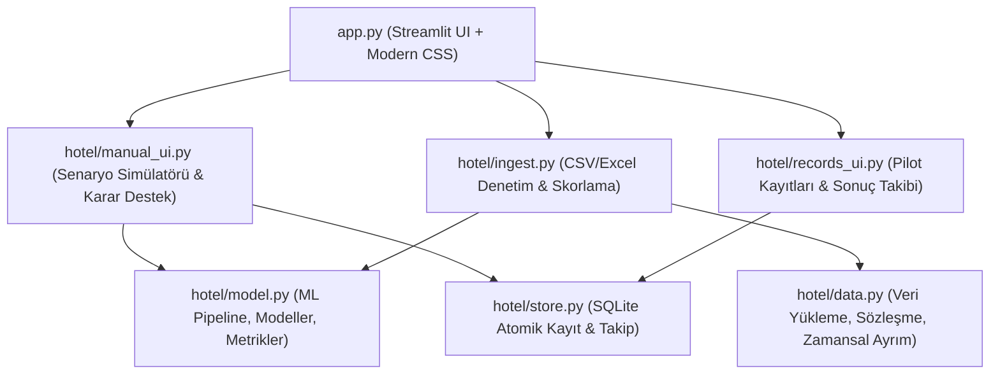

# OTEL REZERVASYON RİSK VE KARAR DESTEK ASİSTANI
## Kapsamlı Proje, Mimari ve Akademik Değerlendirme Raporu

---

### 1. YÖNETİCİ ÖZETİ (EXECUTIVE SUMMARY)
Bu proje; konaklama sektörünün (turizm/otelcilik) en temel gelir kaybı ve operasyonel belirsizlik kaynağı olan **"rezervasyon iptalleri ve gelmeme (no-show)"** olgusunu, makine öğrenmesi ve karar destek sistemleri (Decision Support Systems - DSS) ilkeleriyle çözmeyi amaçlayan uçtan uca bir yapay zekâ yazılımıdır.

Sistem, literatürde ve açık veri dünyasında sıkça düşülen veri sızıntısı (data leakage) tuzaklarını metodolojik olarak bertaraf etmiş; bir rezervasyonun oluşturulduğu ilk anda eldeki verilerle ileride iptal edilip edilmeyeceğini yüksek güvenilirlikle (**ROC-AUC: 0.752, PR-AUC: 0.682**) tahmin eden kalibre edilmiş bir Rastgele Orman (Random Forest) modeli üzerine inşa edilmiştir.

Yazılım; otel yönetiminin (PMS) mevcut rezervasyon listesini toplu olarak yükleyip saniyeler içinde öncelikli takip kuyruğu oluşturabildiği bir **Toplu İnceleme Motoru** ve yeni bir müşteri kaydında parametrelerin risk üzerindeki marjinal etkisini anlık test edebildiği bir **Senaryo Simülatörü** olmak üzere iki temel operasyonel kanala sahiptir.

---

### 2. İŞ PROBLEMİ VE MANTIKSAL ÇERÇEVE

#### 2.1. Otelcilik Sektöründeki Temel Problem
Modern otel işletmelerinde ortalama iptal oranları **%30 ile %40** arasında dalgalanmaktadır. Bu durum iki büyük zarara yol açar:
1. **Boş Kalan Kapasite:** Son dakikaya kadar geleceği varsayılan ancak gelmeyen müşteriler nedeniyle satılamayan odalar (gelir kaybı).
2. **Körlemesine Overbooking Riski:** İptalleri telafi etmek için aşırı oda satışı yapıldığında, misafirlerin beklenenden fazla gelmesi sonucu misafiri başka otele gönderme ("walk" etme), tazminat ödeme ve marka itibarının zedelenmesi.

#### 2.2. Operasyonel Çözüm Mantığı: Erken Karar Desteği
Müdürün veya rezervasyon sorumlusunun binlerce rezervasyonu tek tek incelemesi veya rastgele araması imkânsızdır. İhtiyaç duyulan şey:
* **Rezervasyon Yapıldığı Anda:** Riski tespit edip erken aksiyon almak (ön ödeme/provizyon istemek, iptal edilemez promosyonlu fiyat tanımlamak).
* **Günlük Resepsiyon Operasyonunda:** En riskli rezervasyonları en başa alarak sınırlı arama/teyit kapasitesini (%100 yerine en riskli %10'luk dilime) odaklamak.

---

### 3. VERİ MÜHENDİSLİĞİ VE METODOLOJİ

#### 3.1. Veri Kaynağı ve Kohort Tanımı
* **Veri Seti:** Antonio, Almeida ve Nunes (2019) tarafından yayınlanan ve 2015–2017 yılları arasındaki iki büyük oteli (City Hotel ve Resort Hotel) kapsayan 119.390 satırlık gerçek işlem verisi.
* **Alternatif Veri Seti Entegrasyonu:** Kaggle üzerindeki 36.275 satırlık *INN Hotels Group* veri seti sözleşmeye uyarlanarak sisteme 249 rezervasyonluk bağımsız pilot dosya olarak entegre edilmiştir.
* **Kohort:** 118.565 temiz, mantıksal olarak tutarlı rezervasyon kaydı.

#### 3.2. Data Leakage (Veri Sızıntısı) Nasıl Engellendi?
Akademik projelerde yapılan en yaygın hata, gelecekte veya operasyon esnasında oluşan değişkenlerin modele sokulmasıdır. Sistemimizde katı bir `FORBIDDEN` protokolü uygulanmıştır:
* ❌ `reservation_status` (Check-Out, Canceled vb. — doğrudan hedefi verir)
* ❌ `reservation_status_date` (İptal/çıkış tarihi)
* ❌ `assigned_room_type` (Odaya giriş anında atanır; ayrılan oda tipiyle farkı resepsiyon hamlesidir)
* ❌ `booking_changes` (Rezervasyon oluştuktan sonra yapılan değişiklikler geleceğe aittir)
* ❌ `deposit_type` (Tarihsel kayıtlardaki non-refund kodlaması yapay aşırı öğrenmeye yol açar)
* ❌ `adr` (Sonradan tahsil edilen gerçekleşmiş ortalama oda fiyatı)

**Modele Yalnızca Rezervasyon Anında Bilinen Özellikler Verilmiştir:**
* `lead_time` (Giriş ile rezervasyon oluşturulma arasındaki gün farkı)
* `arrival_month`, `arrival_weekday` (Takvim/sezonsallık faktörleri)
* `stays_in_weekend_nights`, `stays_in_week_nights` (Konaklama kompozisyonu)
* `adults`, `children`, `babies` (Misafir hacmi)
* `hotel`, `meal`, `market_segment`, `distribution_channel`, `reserved_room_type`, `customer_type` (Rezervasyonun yapısal demografisi)

#### 3.3. Zamansal Ayrım (Temporal Train/Test Split)
Rastgele split (k-fold veya random train_test_split) zaman serisi/tarihsel problemlerde geleceği geçmişe sızdırır. Bu sebeple **kesin kronolojik bloklama** uygulanmıştır:
* **Eğitim (Train):** 2015-07-01 ile 2016-06-30 arası (48.360 kayıt)
* **Doğrulama (Validation):** 2016-07-01 ile 2016-09-30 arası (14.545 kayıt — Model seçimi burada yapıldı)
* **Kalibrasyon (Calibration):** 2016-10-01 ile 2016-12-31 arası (13.969 kayıt — Olasılık düzeltmesi)
* **Test:** 2017-01-01 ile 2017-08-31 arası (40.510 kayıt — Gelecek dönem sınaması)

Etiket Olgunlaşması Kuralı: Bir dönemin verisi, sadece tüm sonuçları bir sonraki dönemin başlama tarihinden önce kesinleşmişse eğitime dahil edilmiştir.

---

### 4. MAKİNE ÖĞRENMESİ VE MODEL PERFORMANSI

5 farklı aday algoritma aynı ön işleme boru hattında (Pipeline: Median Imputation + Standard Scaler + One-Hot Encoding) tarafsız biçimde yarıştırılmıştır.

#### 4.1. Model Karşılaştırma Tablosu (Test Verisi: 40.510 Rezervasyon)

| Model Adı | ROC-AUC | PR-AUC (AP) | F1-Score | Brier Skoru | Log-Loss | Açıklama |
| :--- | :---: | :---: | :---: | :---: | :---: | :--- |
| **Genel Oran (Naive)** | 0.5000 | 0.3883 | 0.0000 | 0.2382 | 0.6693 | Temel Referans (Herkes için %38.8) |
| **Otel ve Kanal Oranı** | 0.6310 | 0.4968 | 0.3153 | 0.2264 | 0.6434 | Segmentli Bayesyen Baseline |
| **Lojistik Regresyon** | 0.7208 | 0.6327 | 0.5598 | 0.2070 | 0.6016 | Doğrusal Model |
| **Gradient Boosting** | 0.7584 | 0.6811 | 0.5381 | 0.1935 | 0.5726 | HistGradientBoosting |
| **Rastgele Orman (Seçilen + Kalibre)** | **0.7524** | **0.6817** | **0.5081** | **0.1909** | **0.5597** | **Ayrı dönemde Sigmoid kalibre edilmiş nihai model** |

*Doğrulama kümesinde PR-AUC (Average Precision) başarısı en yüksek olan ve en dengeli olasılık eğrisini veren **Rastgele Orman (Random Forest)** modeli seçilmiştir.*

#### 4.2. Olasılık Kalibrasyonu ve Güvenilirlik
Modelin ürettiği olasılıklar sadece sıralama yapmaz, gerçek hayat oranlarıyla örtüşür (`beats_constant_brier: True`):
* En düşük riskli %10'luk dilimde model tahmini **%12.7** iken gerçek iptal **%8.3**
* En yüksek riskli %10'luk dilimde model tahmini **%86.4** iken gerçek iptal **%85.9**
* Bu durum, modelin ürettiği risk yüzdelerinin operasyonel olarak güvenilir olduğunu ispatlar.

#### 4.3. İşletme Getirisi (Lift / Kapasite Analizi)
* Günde en riskli **10 odayı** inceleyen bir otel, rastgele seçime kıyasla **1.74 kat (%74 daha fazla)** iptal yakalamaktadır.
* Günde en riskli **20 odayı** inceleyen bir otel, rastgele seçime kıyasla **1.58 kat (%58 daha fazla)** iptal yakalamaktadır.

---

### 5. YAZILIM MİMARİSİ VE MODÜLLER (NEREDE NE YAPILDI?)

Proje 6 temel Python modülü ve Streamlit arayüzünden oluşan katmanlı bir mimariye sahiptir:



1. **`hotel/data.py`:** Veri temizleme, `FORBIDDEN` filtreleri, tek tesisli aktif dosya doğrulama sözleşmesi (`validate_active`) ve zamansal ayrım mantığı.
2. **`hotel/model.py`:** Makine öğrenmesi adaylarının pipeline tanımları, `RateBaseline`, Brier/AP/AUC/F1 metrik hesaplayıcıları ve kuyruk analizi (`queue_metrics`).
3. **`hotel/store.py`:** Yerel SQLite veritabanı (`artifacts/tracking.sqlite3`). Model tahminlerinin üzerine asla yazılmadığı (immutability), takip notlarının ve gerçekleşen sonuçların kaydedildiği atomik veri katmanı.
4. **`hotel/ingest.py`:** Dışarıdan yüklenen CSV ve Excel (.xlsx) dosyalarının güvenlik sınırlarını (100 MB zip kontrolü, 100.000 satır sınırı) denetleyip modele ileten katman.
5. **`hotel/scenario.py` & `manual_ui.py`:** Kullanıcı dostu Türkçe etiketleme, deterministik JSON fingerprinting (`sort_keys=True`) ve Karar Destek Sistemi (DSS) aksiyon rozetleri.
6. **`train.py` & `rapor.py`:** Modelleri sıfırdan eğiten, geçici dosyalarla atomik olarak model (`model.joblib`) ve SHA-256 sağlama dosyasını (`model.sha256`) oluşturan ve bağımsız HTML raporu (`artifacts/deney-raporu.html`) üreten komut dosyaları.

---

### 6. KARAR DESTEK SİSTEMİ (DSS) VE EKRAN TASARIMI

Modelin ürettiği olasılıklar son kullanıcı için operasyonel kurallara dönüştürülmüştür:

* 🟢 **Düşük Risk Grubu (< %25):** 
  * *Aksiyon:* Standart operasyon. Ek bir teyit gerekmez, oda garantilidir.
* 🟡 **Orta Risk Grubu (%25 – %50):** 
  * *Aksiyon:* İzleme. Girişten 3–5 gün önce misafire otomatik SMS veya hatırlatma e-postası iletilir.
* 🔴 **Yüksek Risk Grubu ( $\ge$ %50):** 
  * *Aksiyon:* Aktif Müdahale. Kredi kartından ön provizyon talep edilir veya resepsiyon doğrudan telefonla ulaşarak teyit alır.

Arayüz; Streamlit'in standart görünümünden çıkarılmış, özel CSS blokları ile modern degrade kartlar (`linear-gradient`), mikro etkileşimli butonlar ve gölge efektleri (`box-shadow`) ile kurumsal bir görünüm kazanmıştır.

---

### 7. KALİTE GÜVENCESİ VE TEST KAPSAMI

Sistemde hiçbir değişiklik testsiz devreye alınmamıştır. Proje kök dizininde çalışan **39 adet otomatik birim ve entegrasyon testi** mevcuttur:

1. **`tests/test_contract.py`:** Gelecek değişkenlerinin yasaklandığının doğrulanması, kronolojik ayrım sınırları, hatalı/boş dosya yüklemelerinin reddedilmesi, formül enjeksiyonu koruması.
2. **`tests/test_scenarios.py`:** Parmak izi (fingerprint) tutarlılığı, modelin anlamlı risk genişliği ürettiğinin kontrolü (`p_high > 0.40`, `p_low < 0.35`), model dosyasının SHA-256 hash bütünlüğü.
3. **`tests/test_app.py`:** Streamlit sayfalarının hatasız render edilmesi, form gönderme ve SQLite üzerine yazma akışlarının simülasyonu.
4. **`tests/test_backup.py`:** SQLite veritabanı anlık yedeğinin doğruluğu.

```text
============================== 39 passed in 3.50s ==============================
```

---

### 8. GELECEK GELİŞTİRME ÖNERİLERİ (ROADMAP)

Projenin bir sonraki aşamalarında akademik veya ticari olarak eklenebilecek geliştirmeler:
1. **SHAP / LIME ile Açıklanabilir Yapay Zekâ (XAI):** Her bir misafir için riskin hangi 3 faktörden (örn: yüksek lead_time + online kanal) kaynaklandığını gösteren bireysel açıklama çubukları.
2. **Dinamik Fiyatlandırma ve Gelir Yönetimi (Revenue Management):** Yüksek riskli dönemlerde fiyatı düşürmek yerine iptal edilemez (non-refundable) oda paketlerine yönlendiren fiyat optimizasyon modülü.
3. **PMS API Entegrasyonu:** Fidelio/Opera sistemleriyle webhook üzerinden çift yönlü otomatik veri senkronizasyonu.
